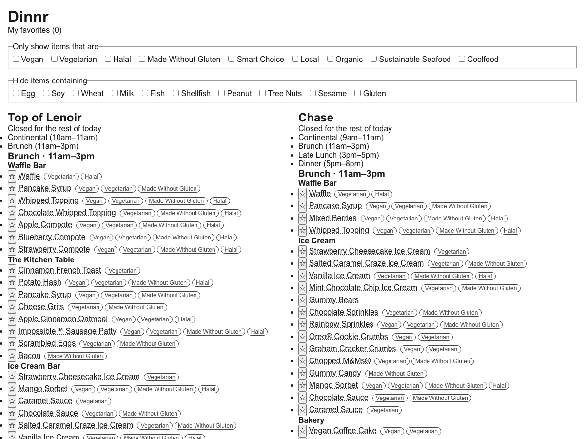

# Dinnr

Compare UNC's two all-you-care-to-eat dining halls, **Top of Lenoir** and **Chase**, side by side,
filter by diet and allergens, and get item combinations that hit your macro goals.

**Live app:** TODO: live URL (not deployed yet; see [`docs/deploy.md`](docs/deploy.md))



<sub>Screenshot of a local run, with the database filled by a scrape of the saved fixture pages
(Saturday 2026-11-07). Only four recipes have saved nutrition responses, so most items show no
macros here. In production every item has them.</sub>

## Why

UNC Dining publishes each hall's menu as its own long page, grouped by station, with nutrition behind
a pop-up for each item. Working out which hall has something you want, without your allergens, and
with about 40 g of protein, means a lot of clicking and adding up by hand. Dinnr puts both halls on
one phone-friendly page:

- **Side by side, for the right meal.** The current meal period, or the next one when nothing is
  being served. Each hall shows its status ("Open now: Brunch until 3pm", "Dinner starts
  at 5pm", "Closed today") and the hours of each meal period, and you can switch to any other meal served today.
- **Favorites first.** Star a dish and it's highlighted, wherever it's served. Dishes are matched by
  normalized name, so "Grilled Chicken Breast" counts at any station in either hall. Each hall shows
  how many of your favorites it's serving.
- **Strict filters.** Diet filters (vegan, vegetarian, halal, made without gluten, ...) and allergen
  filters (egg, soy, wheat, milk, fish, shellfish, peanut, tree nuts, sesame, gluten) hide items
  outright. Whenever an allergen filter is on, a disclaimer says that the filters rely on UNC's labels
  and that cross-contact is possible.
- **Nutrition in one tap.** Calories and protein in the list; tap an item for the full label
  (serving size, macros, sodium, fiber, sugars, micronutrients) and ingredients.
- **Macro combos.** Set optional min/max targets for calories, protein, carbs and fat, and Dinnr
  suggests the top 5 combinations from one hall's meal period that meet all of them.
- **No account.** Favorites, filters and goals are stored in your browser's local storage.

## Architecture

```
            twice daily (GitHub Actions cron)
dining.unc.edu ──▶ Python scraper ──writes──▶ Postgres ◀──reads── Next.js app ──▶ browser
                   (scraper/)                 (migrations/)      (web/)
```

One repo, three areas:

| Path | What | Stack |
| --- | --- | --- |
| [`scraper/`](scraper/) | Fetches, parses and saves the menus and nutrition | Python 3, `uv`, psycopg |
| [`migrations/`](migrations/) | Plain SQL migrations, applied in order by `dinnr-migrate` | Postgres |
| [`web/`](web/) | The app: reads the database, never writes the schema | Next.js 16 (App Router), TypeScript, node-postgres |

**The database schema is the contract** between Python and TypeScript. The scraper side owns the
migrations, and every scheduled run applies pending ones before scraping, so a merged migration
reaches production on the next run.

In production the database is Neon Postgres, the app runs on Vercel, and the scraper runs on a
GitHub Actions schedule. Locally the database is Postgres in Docker.

### Scraper

The scraper is a pipeline of small modules in [`scraper/src/dinnr/`](scraper/src/dinnr/). Only the
fetcher does HTTP, and the parsers are pure functions:

| Module | Role |
| --- | --- |
| `locations.py` | Config: the halls to visit. Adding a hall is one entry, since every location page has the same structure. |
| `fetcher.py` | The only component that does HTTP. Polite by construction (see below). Passed to the rest of the scraper as a dependency, so tests can swap in a fake. |
| `menu_parser.py` | HTML → meal periods (with hours), stations and items (recipe ID, allergens, dietary tags, normalized name). A page with no meal periods is a closed day; a page in an unexpected shape raises. |
| `nutrition.py` | `recipe.php` response → structured nutrition label and ingredients, plus the cache policy: fetch only recipes never seen or fetched more than 30 days ago. |
| `stations.py` | Flags condiment-type stations (Condiments and Spreads, Beverages, Cereal) to leave out of combos. |
| `repository.py` | Writes to Postgres as upserts on natural keys, and prunes items that have left the page, so running twice on the same day updates rows instead of duplicating them. |
| `health.py` | Fails a hall that isn't closed but has no items, or whose item count is under half its recent normal (the median of its open days in the previous 14 days). |
| `archive.py` | Saves every fetched response gzipped, by location and run time, so past days can be re-parsed after a parser bug fix. |
| `run.py` | Orchestration, per hall: fetch → parse → save the menu → fetch missing or stale nutrition → health checks. A failing hall doesn't stop the others; the run fails at the end, naming each hall and why. |
| `cli.py` / `migrate.py` | The `dinnr-scrape` and `dinnr-migrate` entry points. |

### Schema

| Table | Holds |
| --- | --- |
| `location` | slug, name, page URL |
| `menu_day` | one per location per date: open/closed status, when it was scraped |
| `meal_period` | name, position, start and end time (local wall clock) |
| `station` | name, `excluded_from_combos` flag |
| `menu_item` | meal period, station, recipe ID, display name, `normalized_name`, `allergens[]`, `dietary_tags[]` |
| `recipe_nutrition` | per recipe ID: serving size, calories, macros, micronutrients (jsonb), ingredients, `fetched_at` |

Every menu is kept, day after day. That history is what the planned "when is my favorite next
served?" feature will predict from.

### Web app

- **Today data layer** ([`web/src/lib/today.ts`](web/src/lib/today.ts)), server side: given a time
  and the user's preferences, it returns each hall's status, the current or next meal period with
  hours, and stations and items with favorites first and filtered items removed. Diet and allergen
  filters are applied in SQL. Preferences live in the browser and reach the server through a Server
  Function, which validates them again.
- **Combo engine** ([`web/src/lib/combos.ts`](web/src/lib/combos.ts)), a pure TypeScript function
  that runs in the browser. Constraints: at most 3 distinct items, at most 2 whole servings of each,
  condiment-type stations left out unless you turn that off, and diet and allergen filters respected.
  Only combos meeting every target are returned, ranked by fewest items, then whether they contain a
  favorite, then distance from the targets. It's an exhaustive search with pruning: a worst-case
  250-item meal period runs in well under a second.

## Polite scraping

UNC Dining's site is a shared public resource, so the scraper is built to put almost no load on it.

- **Follows robots.txt.** The fetcher reads each host's robots.txt once and refuses any URL it
  disallows. It also never requests a `?date=` URL, whatever robots.txt says, so Dinnr only ever
  reads today's menu.
- **Says who it is.** Every request carries
  `User-Agent: dinnr/<version> (+https://github.com/brandnwalters/dinnr; contact: bmwal@unc.edu)`,
  so UNC Dining can reach the owner.
- **Paces itself.** One request at a time, 5 seconds apart.
- **Caches nutrition.** A recipe's nutrition is fetched once and refreshed only after 30 days, so a
  normal run fetches two menu pages plus a handful of new recipes.
- **Runs twice a day.** At 09:30 UTC (04:30 EST / 05:30 EDT), well before the 7am breakfast, and at
  17:00 UTC (12:00 EST / 13:00 EDT) to pick up changes made during the day. The reasoning about
  daylight saving and scheduling delays is in [`.github/workflows/scrape.yml`](.github/workflows/scrape.yml).
- **Fails loudly.** If a health check fails (for example UNC changes its page layout), the workflow
  run fails and GitHub emails the owner. The raw pages from every run are uploaded as an artifact
  (kept 90 days), even when the run fails, so they can be re-parsed after a fix.

Tests never touch the live site: they use pages saved once, by hand and politely (see
[`fixtures/unc/README.md`](fixtures/unc/README.md)).

## Testing

Tests check external behavior through the highest available seam: inputs in, observable outputs
out. They don't test internal helpers or call order, so refactoring the internals doesn't break them.
There are three seams:

1. **One scraper run** (pytest, [`scraper/tests/`](scraper/tests/)). A fake fetcher serves the
   saved fixture pages to a real scrape, and the test checks the contents of a real Postgres test
   database: items, stations, hours, allergens, tags and normalized names; closed days; nutrition
   fetched only for new or stale recipes (checked by which URLs the fake fetcher was asked for);
   same-day re-runs updating without duplicating; health checks failing the run; the archive; and
   that no `?date=` URL is ever requested.
2. **The combo engine** (vitest, [`web/src/lib/combos.test.ts`](web/src/lib/combos.test.ts)). Pure
   function tests on hand-built item lists: targets met, the 3-item and 2-serving limits, excluded
   stations and the toggle, filters, ranking order, the 5-result cap, an empty result when nothing
   fits, and a worst-case timing budget.
3. **The Today data layer** (vitest, `web/src/lib/today*.test.ts`). Seed a database with a known
   menu, call the data layer with a fixed time and preferences, and check the current vs. next meal
   period, favorites first, allergen and diet filtering, closed halls, and hours.

The UI gets light smoke tests on top of these.

## Run it locally

Prerequisites: Docker, [`uv`](https://docs.astral.sh/uv/), Node 20+, `pnpm`.

```sh
docker compose up -d --wait          # Postgres 17 on localhost:5432 (user/password/db: dinnr)

cd scraper
uv run dinnr-migrate                 # create the schema
uv run dinnr-scrape                  # scrape today's menus from the LIVE UNC site (politely)

cd ../web
pnpm install
pnpm dev                             # http://localhost:3000
```

Both commands and the app read `DATABASE_URL` (default: the local Docker database). The first
scrape into an empty database also fetches nutrition for a few hundred recipes at 5 s each, so it
takes tens of minutes; later runs fetch only new or stale recipes. Please don't run it in a loop.

Tests (both need the Docker Postgres; they create and drop their own databases):

```sh
cd scraper && uv run pytest
cd web && pnpm test
```

More developer notes (test database names, migrations, running checkouts in parallel) are in
[`CONTRIBUTING.md`](CONTRIBUTING.md). Production setup (Neon, the Actions secret, Vercel) is in
[`docs/deploy.md`](docs/deploy.md).

## Planned

- **"When is my favorite next served?"** UNC's page only shows today, and robots.txt rules out
  fetching other dates, so this would be predicted from the saved daily history (or built on
  future menus if Carolina Dining Services gives permission).
- **Notifications** (email or push) when a favorite is on the menu.
- Long-term storage for the raw page archive (beyond the 90-day artifact retention), and more
  dining locations (one config entry each).

## Disclaimer

Dinnr is an independent student project, not affiliated with UNC or Carolina Dining Services. Menus,
nutrition and allergen information come from UNC Dining's public pages and can be wrong or change.
Allergen filters are not a guarantee: cross-contact is possible, so check with dining staff if you
have a severe allergy.
